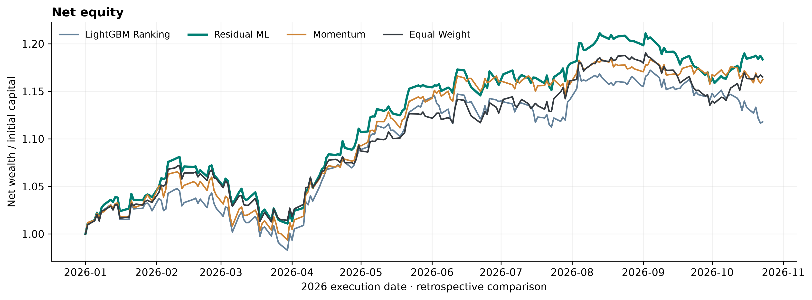
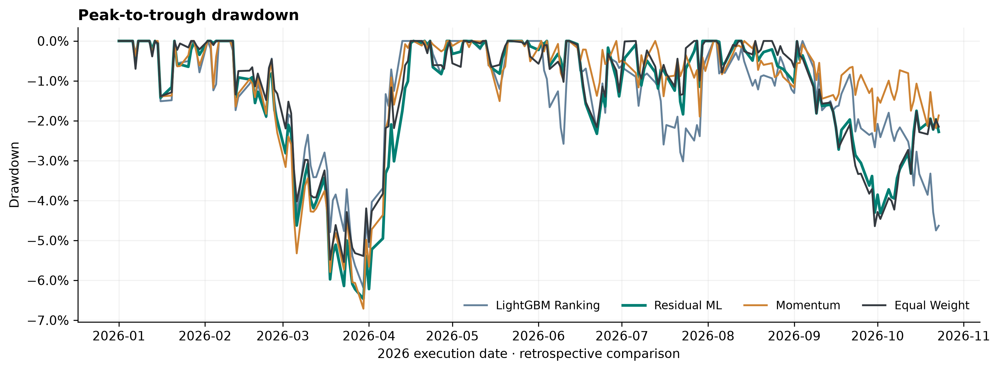

# Quantitative Strategy Research

A reproducible study of cross-sectional equity signals, residual alpha learning and portfolio construction. The unified 2026 comparison evaluates two frozen ML specifications against Momentum and Equal Weight under identical risk, cost and execution assumptions.

**Residual ML achieved 23.14% annualized net return and a 2.11 Sharpe ratio.** Equal Weight had the lowest drawdown. All pairwise excess-return confidence intervals include zero: the realized ML lead is not statistically established superiority.

## Unified 2026 results

**Retrospective comparison—not a fresh holdout.** The sample contains 87 stocks, 17,748 ticker/date observations and 204 execution sessions from January 2 to October 23, 2026. Terminal valuation is October 26; complete 20-session forecast labels extend through November 20.

| Strategy | Net annualized return | Sharpe | Max drawdown | Rank IC | Annual turnover |
|---|---:|---:|---:|---:|---:|
| LightGBM Ranking | 14.77% | 1.32 | 6.19% | -0.0364 | 3.99× |
| Residual ML | 23.14% | 2.11 | 6.47% | -0.0029 | 5.21× |
| Momentum | 20.41% | 1.82 | 6.71% | 0.0016 | 4.43× |
| Equal Weight | 20.78% | 2.04 | 5.54% | — | 3.23× |

Turnover is annualized, two-sided traded notional. Rank IC is the mean daily cross-sectional Spearman correlation against 20-session forward returns; it is undefined for Equal Weight's constant signal.




## Methodology

- **Signals:** LightGBM LambdaRank; Residual ML trained on factor-neutralized returns with volume/liquidity features excluded; 12-minus-1-month Momentum; Equal Weight. Both ML specifications remain frozen. The ranker was refitted once to the same permissible training sample as the residual checkpoint, with labels ending before October 1, 2024.
- **Features and timing:** causal multi-horizon price, volatility, liquidity and cross-sectional features. Signals formed after close trade at the next open. Prediction labels are dividend-inclusive 20-session open-to-open returns.
- **Common portfolio:** long-only, 3% maximum stock weight at rebalance, at most 95% invested, a 10% ex ante volatility target, 20-session rebalancing and identical quadratic turnover penalty. Covariance uses 60 trailing sessions with diagonal shrinkage. Each strategy uses the same allocator; earlier model-specific buffers and exposure-matching allocations are excluded from this comparison.
- **Accounting:** $100,000 initial capital, fractional shares, explicit cash/dividends and terminal liquidation, zero cash yield, and 15 bp costs on each traded side. Rebalance limits can drift between trades; volatility targeting is not a realized-risk guarantee.

## Statistical assessment

Residual ML's annualized mean daily excess return over Momentum is **2.20%**, with a paired 20-session block-bootstrap 95% interval of **[−8.01%, 11.85%]**. Against Equal Weight, it is **2.00% [−3.08%, 8.53%]**. Sixty-session blocks lead to the same qualitative conclusion. These are mean-return differences, not CAGR differences; intervals are pointwise and unadjusted for multiple comparisons.

The universe is survivor-conditioned, corporate-action data is not independently verified, and execution uses reference opens with fixed costs. The short, already-inspected period supports comparison of these implementations, not a claim of persistent alpha. Earlier negative findings and the distinction between initially sealed evaluations and retrospective analyses are retained in the [research history](docs/RESEARCH_HISTORY.md).

## Reproduce and verify

Tested with Python 3.12 on Apple M5. The primary experiment uses CPU; earlier neural models used MPS.

```bash
# macOS: brew install libomp
python3.12 -m venv .venv
source .venv/bin/activate
pip install -r requirements-publication.txt
python -m pytest -q
OMP_NUM_THREADS=1 OPENBLAS_NUM_THREADS=1 python comparison_2026/verify.py
python comparison_2026/report.py
python scripts/verify_publication.py
```

Verification replays checkpoints, recalculates metrics and confidence intervals, and reconciles trades, costs, dividends and equity. Published artifacts support verification without downloading raw market data. [Full reproduction instructions](docs/REPRODUCIBILITY.md) cover frozen model refits, source fingerprints and provider-data revisions.

## Research outputs

| Resource | Contents |
|---|---|
| [Research report](comparison_2026/report.md) | Methods, risk assumptions, full pairwise uncertainty and interpretation |
| [Metrics](comparison_2026/metrics.csv) · [confidence intervals](comparison_2026/excess_return_intervals.csv) | Machine-readable comparison |
| [Verification](comparison_2026/verification.json) | Metric, checkpoint and accounting checks |
| [Vector equity](comparison_2026/figures/equity.pdf) · [vector drawdown](comparison_2026/figures/drawdown.pdf) | Publication-quality figures |
| [Research history](docs/RESEARCH_HISTORY.md) | Audit, baseline, model search, incremental-alpha study and negative findings |

The primary pipeline is in `comparison_2026/`; causal features and portfolio accounting are in `research/engine.py` and `incremental/core.py`. Historical experiment outputs remain in `results/`, `research/` and `incremental/`. Raw provider downloads and rebuildable caches are excluded from version control.
