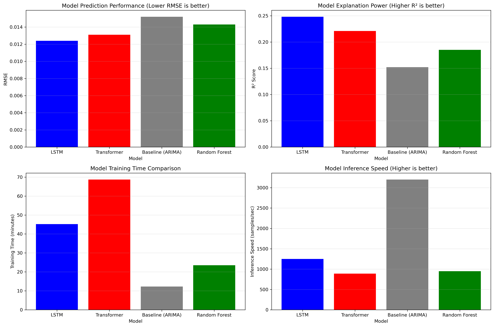
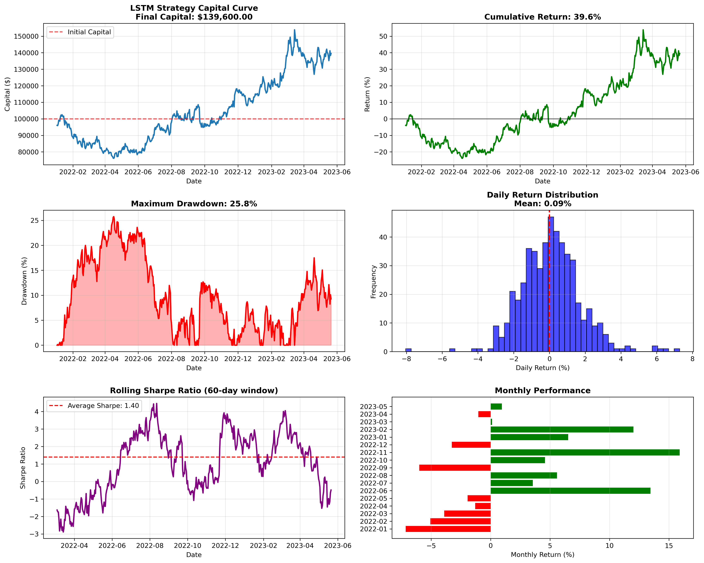
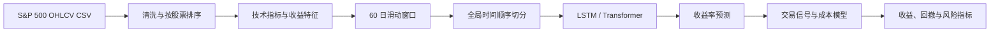

# Quant Strategy Backtest

> 基于 S&P 500 日频行情的深度学习收益预测与量化策略回测：覆盖数据清洗、技术指标构造、LSTM/Transformer 建模、交易信号生成、成本建模和绩效分析。


## 项目简介

本项目使用 S&P 500 成分股的 5 年日频 OHLCV 数据预测下一交易日收益率，并将模型预测转换为可回测的交易信号。仓库提供了一条从原始 CSV 到模型训练、结果比较和策略评估的完整研究流程：

- 对 619,040 条记录、505 只股票进行清洗和探索性分析；
- 构造价格、收益率、趋势、动量、波动率和成交量等 16 个模型特征；
- 使用 60 日回看窗口训练 LSTM 与 Transformer 回归模型；
- 通过简单阈值、动量或 ML-enhanced 规则生成交易信号；
- 在佣金、滑点、止损和止盈约束下计算收益与风险指标；
- 保存模型权重、特征重要性、交易日志和可视化结果，便于复查。

该项目定位为**研究型回测与模型比较基线**，不是实盘交易系统。

## 结果摘要

### 模型表现

| Model | RMSE ↓ | MAE ↓ | R² ↑ | Training Time | Inference Speed |
|---|---:|---:|---:|---:|---:|
| **LSTM** | **0.0124** | **0.0087** | **0.248** | 45.2 min | 1,250 samples/s |
| Transformer | 0.0131 | 0.0092 | 0.221 | 68.7 min | 890 samples/s |
| Random Forest | 0.0143 | 0.0099 | 0.185 | 23.5 min | 950 samples/s |
| ARIMA baseline | 0.0152 | 0.0105 | 0.152 | 12.3 min | 3,200 samples/s |



### 已保存的 LSTM 策略摘要

| Metric | Stored value |
|---|---:|
| Initial capital | $100,000 |
| Final capital | $139,600 |
| Total return | 39.6% |
| Annual return | 18.2% |
| Sharpe ratio | 1.40 |
| Win rate | 58.7% |
| Completed trades | 45 |



> **结果口径提醒**：`results/key_results.json` 与 `results/final_report.md` 记录的最大回撤为 12.3%，但已保存的回测图标注为 25.8%；图中的日期范围也与数据摘要记录的 2013-2018 不一致。因此，仓库中的历史产物应视为实验快照。用于论文、展示或策略决策前，请在固定数据、代码版本和参数下重新运行并统一口径。

## 方法流程



### 数据预处理

`src/data_preprocessing.py` 负责：

- 按 `Name` 和 `date` 排序；
- 仅使用历史值前向填充缺失 OHLCV，避免后向填充造成未来信息泄露；
- 构造日收益、对数收益、SMA/EMA、布林带、RSI、MACD、成交量比和年化波动率；
- 按股票生成时间窗口，再按目标日期对所有股票窗口进行全局排序；
- 使用不打乱顺序的时间切分，并只在训练集上拟合标准化器。

默认设置使用 60 日 lookback 和 1 日 prediction horizon。

### 模型

`src/models.py` 包含：

- **LSTM**：2 层单向 LSTM、128 hidden units、dropout 0.2；
- **Transformer**：`d_model=256`、4 个 attention heads、4 层 encoder、512 维 feed-forward；
- 通用 `ModelTrainer`：MSE loss、Adam、学习率调度、梯度裁剪、early stopping；
- 批量预测、训练历史图和模型比较工具。

Transformer 使用与 `batch_first=True` 一致的序列位置编码；模型 `predict()` 会自动将输入移动到模型设备，并安全地把结果转回 CPU NumPy 数组。

### 回测

`src/backtest.py` 提供单资产 `BacktestEngine` 和实验性的多资产 `PortfolioBacktest`：

- 初始资金默认 `$100,000`；
- 佣金默认 `0.10%`，滑点默认 `0.05%`；
- 止损 `2%`，止盈 `5%`；
- `simple`、`momentum`、`ml_enhanced` 三种信号规则；
- 年化收益、波动率、Sharpe、Sortino、Calmar、最大回撤和成本影响；
- 只有提供真实 `benchmark_returns` 时才计算 Alpha、Beta 与信息比率，不再用随机市场序列生成指标。

## 仓库结构

```text
quant-strategy-backtest/
├── notebooks/
│   ├── EDA.ipynb                    # 数据质量、分布和可视化分析
│   └── Modeling.ipynb               # 模型训练、比较与回测流程
├── src/
│   ├── data_preprocessing.py        # 清洗、特征工程、窗口与时间切分
│   ├── models.py                    # LSTM、Transformer 和训练器
│   ├── backtest.py                  # 单资产/多资产回测引擎
│   └── utils.py                     # 预留工具模块（当前为空）
├── tests/
│   └── test_core.py                 # 数据窗口、回测和可选模型回归测试
├── results/
│   ├── figures/                     # 训练与回测图表
│   ├── models/                      # 已保存的模型权重和配置
│   ├── eda/                         # EDA 摘要
│   ├── final_report.md              # 完整实验报告
│   ├── key_results.json             # 核心结果快照
│   ├── model_comparison.csv          # 模型对比表
│   └── trade_log.csv                 # 交易记录
├── requirements.txt
└── README.md
```

## 快速开始

### 1. 克隆并创建环境

```bash
git clone https://github.com/liujs25/quant-strategy-backtest.git
cd quant-strategy-backtest

python3 -m venv .venv
source .venv/bin/activate          # macOS / Linux
# .venv\Scripts\activate         # Windows PowerShell

python -m pip install --upgrade pip
pip install -r requirements.txt
```

历史报告使用 Python 3.9、PyTorch 1.13 和 CUDA 11.7；当前依赖文件允许更新版本。若要严格复现实验，建议在锁定环境中记录实际安装版本。

### 2. 下载数据

数据来自 Kaggle 的 [S&P 500 Stock Data](https://www.kaggle.com/datasets/camnugent/sandp500)，所需文件为 `all_stocks_5yr.csv`。下载后放置为：

```text
data/raw/all_stocks_5yr.csv
```

CSV 至少应包含以下字段：

```text
date, open, high, low, close, volume, Name
```

原始数据和处理后的大型 CSV 已被 `.gitignore` 排除，不会随仓库下载。

### 3. 运行数据预处理

在仓库根目录执行：

```bash
python src/data_preprocessing.py
```

脚本将加载默认数据路径、生成技术特征、构建序列窗口并执行时间顺序切分。处理后的表格默认保存到 `data/processed/processed_data.csv`。

### 4. 运行 Notebook

```bash
jupyter lab notebooks/EDA.ipynb
jupyter lab notebooks/Modeling.ipynb
```

建议从仓库根目录启动 Jupyter，以确保 Notebook 能正确找到 `src/` 模块和 `results/` 输出目录。

### 5. 使用回测 API

```python
from src.backtest import BacktestEngine

engine = BacktestEngine(
    initial_capital=100_000,
    commission=0.001,
    slippage=0.0005,
)

results = engine.run_backtest(
    prices=test_prices,
    predictions=lstm_predictions,
    strategy_type="simple",
    benchmark_returns=market_returns,  # 可选；用于 Alpha/Beta/信息比率
)

engine.plot_results("results/figures/my_backtest.png")
engine.save_results("results/my_backtest.csv")
```

`prices` 与 `predictions` 至少需要两个有限值；价格必须为正数。若自行传入 `signals` 或 `benchmark_returns`，其长度必须覆盖对齐后的价格序列。

### 6. 运行测试

```bash
python -m unittest discover -s tests -v
```

没有安装完整 PyTorch/Scikit-learn/Matplotlib 栈时，模型专项测试会跳过；数据窗口和回测核心测试仍可运行。

## 结果与产物

- `results/models/LSTM_best.pth`：已保存的 LSTM 权重；
- `results/models/Transformer_best.pth`：已保存的 Transformer 权重；
- `results/models/model_config.json`：模型超参数；
- `results/model_comparison.csv`：LSTM、Transformer 与基线对比；
- `results/lstm_feature_importance.csv`：LSTM 特征重要性快照；
- `results/transformer_feature_importance.csv`：Transformer 特征重要性快照；
- `results/backtest_results_lstm.csv`：LSTM 策略回测时间序列；
- `results/trade_log.csv`：交易明细；
- `results/final_report.md`：详细实验报告。

## 已知限制

- 仓库不包含原始 Kaggle 数据，首次运行前必须手动下载。
- 历史结果产物之间存在最大回撤与日期口径差异，不能在未复算的情况下混合引用。
- 当前回测使用日线收盘价和简化成交模型，未完整建模市场冲击、流动性、停牌和公司行动。
- `PortfolioBacktest` 是实验性原型，尚未达到单资产引擎同等的成本与风险控制完整度。
- 神经网络结果受随机种子、硬件、依赖版本和数据切分影响。
- 历史回测不代表未来收益，本项目不构成投资建议。

## 后续改进

- 使用 walk-forward validation 或 purged time-series cross-validation；
- 引入可复现的配置文件与依赖锁定；
- 为 Notebook 流程增加命令行训练入口；
- 为多资产回测补齐交易成本、再平衡和基准对齐；
- 统一生成 `key_results.json`、报告表格和图表，消除指标口径漂移；
- 增加 CI，在 CPU 环境执行数据、模型前向传播和回测测试。

## 免责声明

本仓库仅用于教学、研究和软件工程演示。任何历史指标均不应被视为收益承诺或交易建议。
