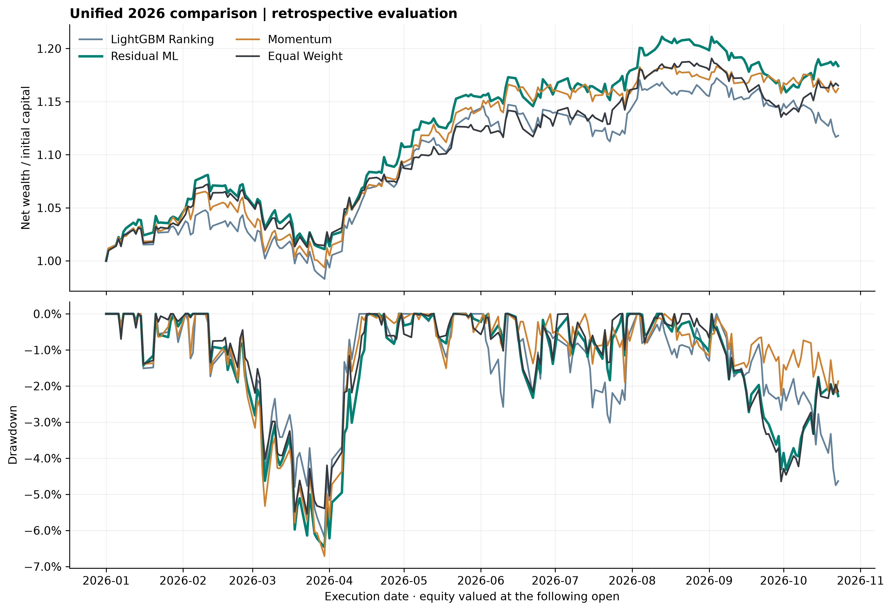

# Unified 2026 strategy comparison

## Results

Residual ML achieved **23.14% annualized net return**, **2.11 Sharpe** and **6.47% maximum drawdown**. It led realized return and Sharpe under the common allocator; Equal Weight had the smallest drawdown. All pairwise excess-return intervals include zero at both block lengths.

This is a **retrospective comparison, not a fresh holdout evaluation**. The 2026 observations had been inspected before this comparison. No model hyperparameters, strategy parameters or risk settings were tuned on these results.

| Strategy | Net annualized return | Sharpe | Max drawdown | Rank IC | Annual turnover |
|---|---:|---:|---:|---:|---:|
| LightGBM Ranking | 14.77% | 1.32 | 6.19% | -0.0364 | 3.99× |
| Residual ML | 23.14% | 2.11 | 6.47% | -0.0029 | 5.21× |
| Momentum | 20.41% | 1.82 | 6.71% | 0.0016 | 4.43× |
| Equal Weight | 20.78% | 2.04 | 5.54% | — | 3.23× |

## Sample and information boundaries

All four strategies use 87 tradable stocks and an identical 88-name feature-ranking reference set. There are 17,748 common ticker/date observations across 204 execution sessions, 2026-01-02–2026-10-23. Terminal next-open liquidation is 2026-10-26. All 20-session forward labels finish by 2026-11-20, so the traded interval ends before the downloaded data endpoint.

Both ML models use the same 297,762 training observations with label-end dates strictly before 2024-10-01. This cutoff also precedes the longest raw feature history used by evaluation observations. The earlier ranker checkpoint was trained on less recent information; refitting its frozen specification on the residual model's permissible sample removes that training-information mismatch. This is one fixed refit, not new model selection.

## Models and signals

**LightGBM Ranking:** the previously frozen LambdaRank specification, 120 trees, depth 3, 8 leaves, learning rate 0.03, minimum leaf size 200, L2 penalty 10 and seed 42. Labels are per-date forward-return relevance quintiles. All original financial features are retained.

**Residual ML:** the previously frozen no-volume/liquidity feature ablation. Training 20-session returns are projected off an intercept and known-at-signal long momentum, medium momentum, volatility and reversal proxies. A fixed shallow LightGBM regressor learns those residuals. Evaluation scores are projected off contemporaneous factor features without evaluation labels. The existing checkpoint is reused, and its full prediction vector reproduces the previous saved scores exactly.

**Momentum:** the existing 12-minus-1-month momentum rank. **Equal Weight:** a zero cross-sectional signal, producing equal stock weights at rebalance before common volatility scaling.

Model outputs are allocation/ranking scores, not equally calibrated return forecasts. Rank IC measures each pre-allocation signal against the same 20-session dividend-inclusive forward returns. It does not measure portfolio-weight correlation or isolate incremental factor alpha. Equal Weight's Rank IC is undefined. Overlapping 20-session labels are not independent observations.

## Identical portfolio construction

All signals enter the same optimizer, using per-date standardized scores, an equal-weight starting allocation, quadratic inertia 1.0 relative to the previous unscaled target, 3% stock caps at rebalance and at most 95% total investment. A 60-session trailing close-return covariance estimate, annualized by 252 and shrunk 25% toward its diagonal, scales exposure downward toward 10% ex ante volatility. There is no upward leverage or shorting. Rebalance every 20 sessions. Weight limits can drift between rebalances, and common constraints do not imply identical realized exposures or risk.

The trading-inertia penalty is a turnover surrogate against a previous target, not exact transaction-cost minimization against drifted current shares. Actual costs and turnover use executed share changes.

Earlier strategy-specific allocators are not part of this standardized experiment: the original ranker's top-20 buffer and the residual strategy's momentum-reference exposure-matching allocation are replaced by the common allocator. The residual model's score projection remains intact, but no portfolio receives special factor constraints. Thus “original LightGBM Ranking” means its frozen predictive specification under standardized portfolio construction, not its former full trading implementation.

This also explains why Residual ML returned 19.41% annualized in the preceding incremental study and 23.14% here. The former used a momentum-reference allocation with exposure matching. Both outputs and their assumptions remain preserved; neither is silently substituted for the other.

## Execution and metric definitions

Signals formed after close enter at the next reference open. The ledger sells before buying, constrains trades to cash, retains fractional shares between rebalances, credits dividends when carried into the next ex-date open, and liquidates all holdings at the common terminal open. Initial capital is $100,000. Both sides pay 15 bp on traded notional, including terminal sales. Cash yield and risk-free rate are zero.

Annualized net return is terminal-wealth CAGR using 252/N sessions. Sharpe is daily net mean divided by sample standard deviation times sqrt(252). Maximum drawdown includes initial capital. Turnover is two-sided reference notional divided by daily pre-trade NAV, annualized by 252. Rank IC is the mean daily cross-sectional Spearman correlation. Daily NAVs are indexed by execution date and valued at the following open, including the initial and final costs.

## Paired excess-return uncertainty

| Strategy − comparator | Block length | Annualized mean excess | 95% interval |
|---|---:|---:|---:|
| LightGBM Ranking − Residual ML | 20 | -6.96% | [-19.71%, 4.50%] |
| LightGBM Ranking − Momentum | 20 | -4.76% | [-12.82%, 3.92%] |
| LightGBM Ranking − Equal Weight | 20 | -4.97% | [-19.22%, 8.62%] |
| Residual ML − Momentum | 20 | 2.20% | [-8.01%, 11.85%] |
| Residual ML − Equal Weight | 20 | 2.00% | [-3.08%, 8.53%] |
| Momentum − Equal Weight | 20 | -0.20% | [-11.61%, 11.71%] |
| LightGBM Ranking − Residual ML | 60 | -6.96% | [-18.45%, 2.34%] |
| LightGBM Ranking − Momentum | 60 | -4.76% | [-12.48%, 2.26%] |
| LightGBM Ranking − Equal Weight | 60 | -4.97% | [-17.87%, 7.58%] |
| Residual ML − Momentum | 60 | 2.20% | [-3.72%, 9.16%] |
| Residual ML − Equal Weight | 60 | 2.00% | [-2.59%, 7.73%] |
| Momentum − Equal Weight | 60 | -0.20% | [-9.79%, 9.65%] |

The statistic is mean paired daily net-return difference multiplied by 252, **not the difference in CAGR**. Intervals use a circular whole-date moving-block bootstrap with 5,000 replications, seed 42 and both 20- and 60-session blocks. Every pair uses the same resampled dates for a given block length. All six pairs are reported. Intervals are pointwise 95%, not multiplicity-adjusted discovery tests.

Residual ML's advantage over Momentum is 2.20% annualized mean excess return, with intervals [−8.01%, 11.85%] and [−3.72%, 9.16%]. Against Equal Weight, it is 2.00%, with intervals [−3.08%, 8.53%] and [−2.59%, 7.73%]. Neither establishes superiority. Its slightly negative Rank IC alongside a positive portfolio advantage reflects different statistics: all-stock/date ranking versus periodic constrained holdings and exposure paths. Both measurements are retained.

## Limitations and research status

The sample is short and already inspected; long bootstrap blocks contain few effectively independent observations. The fixed universe is survivor-conditioned and lacks verified historical constituent membership and delisting coverage. Source OHLC and explicit dividend data do not constitute an independently validated corporate-action ledger. Reference-open fills, fractional shares and fixed costs omit measured auction impact and capacity constraints. Sector, value and profitability exposures are not neutralized. These assumptions apply equally to all four strategies but limit economic interpretation.

The earlier 2024–2025 and 2026 evaluations were initially sealed until their respective selection locks. They became exploratory after inspection. The 2024–2025 study also records a post-reveal rank-reference repair and retains both calculations. The current comparison is explicitly retrospective; it does not create a new untouched test. See [research history](../docs/RESEARCH_HISTORY.md) for all stages, failed gates, ablations and negative findings.

## Verification and reproduction

The published verifier replays both checkpoints, recomputes all reported metrics and bootstrap intervals, reconciles cash, positions, dividends, costs and terminal wealth, and checks dates and allocation limits. `results.json` records frozen source/specification hashes and sample metadata. Per-strategy predictions, daily equity, trades, weights and IC observations are retained. PNG figures are 300 dpi; PDF versions are vector.

See [reproduction instructions](../docs/REPRODUCIBILITY.md), [verification output](verification.json) and [regression results](regression_tests.txt). The experiment ran locally on Apple M5 CPU; GPU acceleration is not beneficial for these small tree/optimizer workloads. Earlier neural studies used MPS. The completed-run guard prevents accidental overwrite.
