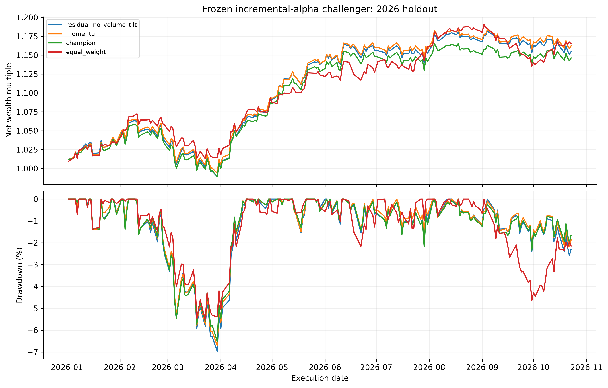
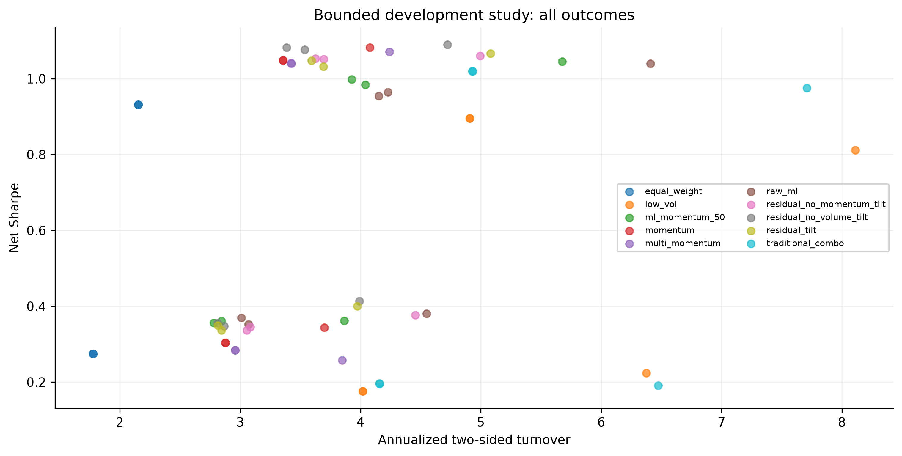
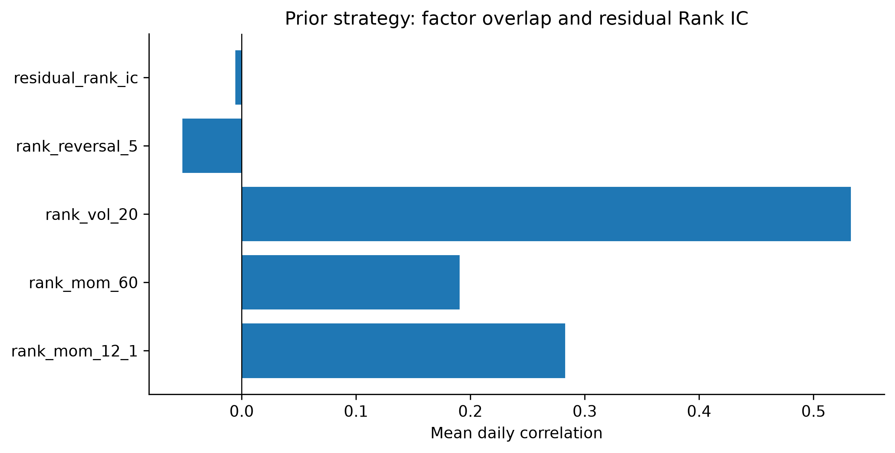

# Incremental ML alpha study — local, verified, unpublished

## Outcome

Statistically credible incremental ML alpha is not established: at least one specified benchmark-relative interval includes zero or is negative. Do not promote a favorable absolute return, Sharpe or one uncertainty estimate into an alpha claim. The development gate passed: **False**. The selected implementation is an **exploratory challenger**, not an approved replacement strategy when the gate fails. All prior experiments are preserved; 2024–2025 is explicitly exploratory. No commit or push occurred.

## Why the previous LightGBM strategy was not convincing alpha

On the inspected 2024–2025 period, average daily score-rank correlations with long momentum, medium momentum and volatility were approximately 0.283, 0.191 and 0.533. After cross-sectionally projecting both scores and forward returns off the factor proxies, residual Rank IC was -0.0057. The descriptive daily return regression on the same-universe market and long-short momentum/volatility/reversal proxies explained 94.2% of variation; annualized intercept was -7.15%, HAC t=-1.97. These proxies are not official factor series; the regression is retrospective, conditional, and cannot prove causal exposure or independent alpha. Volatility exposure was particularly substantial.

## Focused design, not an unrestricted model search

Fixed LightGBM regression settings: 120 trees, depth 3, 8 leaves, learning rate .03, minimum leaf 200, L2 penalty 10, seed42, one CPU thread. Apple M5 local compute only; these small tree/convex-optimization workloads do not benefit from MPS. No additional neural architecture sweep.

Four target/feature configurations: raw 20-session return; residual return with all features; residual return excluding momentum/trend features; residual return excluding volume/liquidity features. For each training date, regress its future20-session returns on an intercept and **known-at-signal** long momentum, medium momentum, volatility and reversal ranks, using all training stocks. The residual is the training label. Using training future returns to define training labels is legitimate; no evaluation labels enter these regressions or fitted trees. Prediction scores are projected off the same contemporaneous factors without looking at future returns. Removing momentum features does not remove portfolio momentum: residual strategies intentionally tilt a common momentum reference.

Ten predefined signals include equal weight, long momentum, multi-horizon momentum, low volatility, a traditional factor combination, raw ML, three residual tilts and a 50/50 standardized residual/momentum blend. Three predefined risk settings vary quadratic trading inertia (0.1 or1.0) and maximum weight (5% or3%). Eight fitted models total across two development folds; 60 portfolio evaluations. All results and ablations are retained.

Development folds: 2022–2023 and 2024–2025, training labels ending before 2020-10-01 and2022-10-01 respectively. These gaps exceed the longest raw feature history. Both folds are now **research/selection data**, not independent evidence. The prior 2021–2023 searches also mean historical validation scores are affected by research history. A fixed 2026 holdout was declared before retrieval, downloaded only after selection lock, and evaluated without changes to selection or portfolio settings. Final training labels end before2024-10-01. The 2026 holdout is retrospective and under one year, not a prospective live trial.

Selection maximizes mean paired active-return information ratio versus same-risk momentum; a candidate is eligible only if both development folds have positive active mean return, average Sharpe improves, and neither fold worsens drawdown. No candidate passed all conditions; the best predefined challenger is retained rather than relaxing the gate. Locked choice: `residual_no_volume_tilt`, risk `diversified`. Its worst development drawdown difference was 0.0857%. Traditional champion selected independently from development: `{'strategy': 'momentum', 'risk': 'responsive'}`.

| fold | sharpe | annualized_return | max_drawdown | annualized_turnover | rank_ic |
|---|---|---|---|---|---|
| 0 | 0.355188 | 0.0360246 | 0.106405 | 2.81293 | -0.00318133 |
| 1 | 1.08242 | 0.149582 | 0.163052 | 3.38477 | -0.0486297 |

## Common risk, factor constraints and execution

Every strategy is long-only, unlevered, at most95% invested, rebalanced every20 sessions, with identical15-bp one-way commission/slippage. Covariance uses only the trailing60 close-return observations through the signal close, annualizes by252, and shrinks25% toward diagonal. Portfolios are scaled down toward10% ex ante annualized volatility, never up with leverage. This is a target, not a realized-volatility or drawdown guarantee. Overnight gaps and covariance estimation error remain.

The optimizer minimizes distance to a score-tilted diversified allocation plus a quadratic penalty relative to its previous unscaled target. The penalty is a **turnover surrogate**, not exact transaction-cost minimization against drifted actual shares. Actual share changes, costs and turnover are calculated in the ledger. Position caps apply at rebalance; weights can drift between rebalances. Same-risk traditional baselines face the same rules. The separately selected traditional champion may use a different member of the same prespecified risk grid; its comparison is disclosed rather than called identical.

Residual tilts preserve the momentum reference's four proxy exposures **before volatility scaling**. Since strategies may receive different volatility multipliers, actual dollar factor exposures are not perfectly identical. Realized exposure files and HAC return regressions document that distinction. There are no sector/value/profitability neutralizations because reliable point-in-time sector/fundamental data are absent. Factor neutrality is limited to these observable price-based proxies and is not full factor neutrality.

Orders use prior-close features and next-open reference prices. Trades sell before buying, obey available cash, retain shares between rebalances, accrue dividends entering the next ex-date open, and liquidate at the last observed open with costs. Zero cash yield, fractional shares, no taxes/borrow or auction impact. Source Yahoo OHLC is split-adjusted with explicit dividends; corporate actions and revisions are not independently validated. Universe remains87 tradable stocks with the same88-name rank reference, including development survivor conditioning; missing holdout security/price data must fail rather than be silently dropped.

## Fresh final evaluation

17,748 observations, 204 sessions, 2026-01-02 00:00:00–2026-10-23 00:00:00. The requested endpoint was2026-11-20; observations whose20-session label would finish later are excluded consistently for every strategy. This shortens the traded period. No final retuning.

| strategy | annualized_return | total_return | sharpe | max_drawdown | annualized_turnover | transaction_costs | final_equity |
|---|---|---|---|---|---|---|---|
| residual_no_volume_tilt | 0.194135 | 0.154454 | 1.73697 | 0.0697045 | 4.39746 | 582.281 | 115445 |
| equal_weight | 0.20779 | 0.165129 | 2.0367 | 0.05543 | 3.22916 | 427.372 | 116513 |
| momentum | 0.204139 | 0.162277 | 1.82379 | 0.0671259 | 4.42762 | 586.32 | 116228 |
| multi_momentum | 0.182929 | 0.145676 | 1.7397 | 0.0568163 | 4.64514 | 614.934 | 114568 |
| low_vol | 0.14868 | 0.118749 | 1.41155 | 0.068622 | 6.08208 | 784.356 | 111875 |
| traditional_combo | 0.214338 | 0.17024 | 1.96665 | 0.0727957 | 6.45059 | 858.285 | 117024 |
| champion | 0.183661 | 0.14625 | 1.68252 | 0.0652019 | 4.92165 | 649.593 | 114625 |

Score IC/Rank IC/ICIR: `{"n": 17748, "rmse": null, "mae": null, "r2": null, "directional_accuracy": null, "ic": 0.02622237210142398, "rank_ic": -0.002855605681800311, "icir": 0.1462593008913471, "ic_valid_days": 204}`. These are allocation/ranking scores rather than calibrated20-day return forecasts; raw RMSE/MAE/R² and directional accuracy are deliberately undefined. Baseline raw-return prediction diagnostics are retained in development files and must not be interpreted as fair error comparisons with factor scores.

| comparator | block | mean_active_annualized | ci_low | ci_high |
|---|---|---|---|---|
| momentum | 20 | -0.00829984 | -0.0225146 | 0.00837255 |
| momentum | 60 | -0.00829984 | -0.0211034 | 0.00432946 |
| champion | 20 | 0.00901805 | -0.0152391 | 0.0334328 |
| champion | 60 | 0.00901805 | -0.00894378 | 0.0265713 |

Intervals use paired whole-date circular block bootstrap, 5,000 resamples each, seed42, both20- and60-session blocks. The statistic is average daily net-return difference×252, not CAGR difference. Twenty-session forward-label overlap and regime dependence make naive independent-observation inference invalid. Daily portfolio returns are used for economic inference; block sensitivity is reported, not selected. Less than a year gives few independent long blocks. Selection among30 strategy/risk combinations occurred on development only, but prior research history, universe conditioning and short sample still constrain inference. No risk-free adjustment or official multifactor alpha is claimed.





## Verification and reproduction

`verification.json` records checkpoint replay and reconciliation of cash, holdings, costs, dividends, returns and terminal liquidation; factor-neutrality constraints and rebalance caps are tested. `regression_tests.txt` records all regression tests. Source/data hashes and selection-lock hashes preserve provenance. Prior outputs remain in `research/` and `results/`; new active study is isolated in `incremental/`.

From repository root using the existing local environment and `requirements-research-lock.txt`:

```bash
OMP_NUM_THREADS=1 OPENBLAS_NUM_THREADS=1 python incremental/study.py
python incremental/select.py
python incremental/download_holdout.py
OMP_NUM_THREADS=1 OPENBLAS_NUM_THREADS=1 python incremental/final.py
python incremental/verify.py
python incremental/diagnostics.py
python incremental/report.py
python -m pytest -q
```

Completed lock/final scripts refuse overwrite. Replicate in a separate local copy with original frozen input snapshots and empty new output folders; do not call a rerun after inspecting this report untouched. The final2026 period is now inspected. Any further model selection needs new independent data or prospective observations, not recycling this period until a positive result appears. Nothing is published without explicit user approval.

## Prespecified cost stress, no reselection

| strategy | cost_one_way | annualized_return | sharpe | transaction_costs |
|---|---|---|---|---|
| residual_no_volume_tilt | 0 | 0.201928 | 1.79282 | 0 |
| momentum | 0 | 0.21204 | 1.87966 | 0 |
| residual_no_volume_tilt | 0.0005 | 0.199326 | 1.77434 | 194.382 |
| momentum | 0.0005 | 0.209402 | 1.86118 | 195.725 |
| residual_no_volume_tilt | 0.0015 | 0.194135 | 1.73697 | 582.281 |
| momentum | 0.0015 | 0.204139 | 1.82379 | 586.32 |
| residual_no_volume_tilt | 0.003 | 0.186385 | 1.6799 | 1161.97 |
| momentum | 0.003 | 0.196282 | 1.76659 | 1170.09 |

## Full development ablation table

| fold | strategy | risk | annualized_return | sharpe | max_drawdown | annualized_turnover |
|---|---|---|---|---|---|---|
| 0 | equal_weight | responsive | 0.0254536 | 0.274443 | 0.12486 | 1.77762 |
| 0 | equal_weight | sticky | 0.0254536 | 0.274443 | 0.12486 | 1.77762 |
| 0 | equal_weight | diversified | 0.0254536 | 0.274443 | 0.12486 | 1.77762 |
| 0 | momentum | responsive | 0.0346225 | 0.34388 | 0.110768 | 3.69914 |
| 0 | momentum | sticky | 0.0295408 | 0.303402 | 0.109739 | 2.87781 |
| 0 | momentum | diversified | 0.0295433 | 0.303422 | 0.109739 | 2.87794 |
| 0 | multi_momentum | responsive | 0.0238965 | 0.257096 | 0.12026 | 3.84817 |
| 0 | multi_momentum | sticky | 0.0273371 | 0.283888 | 0.114283 | 2.95863 |
| 0 | multi_momentum | diversified | 0.027299 | 0.283742 | 0.114402 | 2.95845 |
| 0 | low_vol | responsive | 0.0190007 | 0.224084 | 0.139051 | 6.37416 |
| 0 | low_vol | sticky | 0.0136124 | 0.176006 | 0.134923 | 4.01717 |
| 0 | low_vol | diversified | 0.0136127 | 0.176009 | 0.134923 | 4.01717 |
| 0 | traditional_combo | responsive | 0.0156433 | 0.190636 | 0.131571 | 6.47393 |
| 0 | traditional_combo | sticky | 0.0162485 | 0.195236 | 0.127403 | 4.15905 |
| 0 | traditional_combo | diversified | 0.0163612 | 0.196168 | 0.127415 | 4.15599 |
| 0 | raw_ml | responsive | 0.038593 | 0.380591 | 0.104219 | 4.54885 |
| 0 | raw_ml | sticky | 0.0349882 | 0.351989 | 0.111311 | 3.06938 |
| 0 | raw_ml | diversified | 0.0370179 | 0.369436 | 0.111261 | 3.00902 |
| 0 | residual_tilt | responsive | 0.0418739 | 0.399724 | 0.106331 | 3.97478 |
| 0 | residual_tilt | sticky | 0.0338314 | 0.336594 | 0.104712 | 2.84535 |
| 0 | residual_tilt | diversified | 0.0353437 | 0.349397 | 0.105885 | 2.81421 |
| 0 | residual_no_momentum_tilt | responsive | 0.0386696 | 0.376723 | 0.110056 | 4.45627 |
| 0 | residual_no_momentum_tilt | sticky | 0.034738 | 0.345298 | 0.107823 | 3.08369 |
| 0 | residual_no_momentum_tilt | diversified | 0.0335951 | 0.336674 | 0.10946 | 3.05472 |
| 0 | residual_no_volume_tilt | responsive | 0.0434281 | 0.413159 | 0.10652 | 3.99038 |
| 0 | residual_no_volume_tilt | sticky | 0.0351473 | 0.347756 | 0.10623 | 2.86812 |
| 0 | residual_no_volume_tilt | diversified | 0.0360246 | 0.355188 | 0.106405 | 2.81293 |
| 0 | ml_momentum_50 | responsive | 0.0370358 | 0.361953 | 0.106091 | 3.86509 |
| 0 | ml_momentum_50 | sticky | 0.0367781 | 0.360642 | 0.104391 | 2.84592 |
| 0 | ml_momentum_50 | diversified | 0.0360388 | 0.356119 | 0.107471 | 2.77952 |
| 1 | equal_weight | responsive | 0.121535 | 0.931936 | 0.157102 | 2.15375 |
| 1 | equal_weight | sticky | 0.121535 | 0.931936 | 0.157102 | 2.15375 |
| 1 | equal_weight | diversified | 0.121535 | 0.931936 | 0.157102 | 2.15375 |
| 1 | momentum | responsive | 0.151658 | 1.08192 | 0.161023 | 4.07626 |
| 1 | momentum | sticky | 0.144683 | 1.0485 | 0.162184 | 3.35532 |
| 1 | momentum | diversified | 0.144676 | 1.04846 | 0.162195 | 3.35558 |
| 1 | multi_momentum | responsive | 0.155854 | 1.07136 | 0.174258 | 4.24084 |
| 1 | multi_momentum | sticky | 0.148974 | 1.03948 | 0.172957 | 3.42557 |
| 1 | multi_momentum | diversified | 0.149146 | 1.04162 | 0.172949 | 3.42194 |
| 1 | low_vol | responsive | 0.0939042 | 0.811278 | 0.146857 | 8.11105 |
| 1 | low_vol | sticky | 0.104073 | 0.895446 | 0.141783 | 4.90705 |
| 1 | low_vol | diversified | 0.104073 | 0.895445 | 0.141783 | 4.90705 |
| 1 | traditional_combo | responsive | 0.128675 | 0.975183 | 0.160645 | 7.70888 |
| 1 | traditional_combo | sticky | 0.134983 | 1.01951 | 0.15783 | 4.92947 |
| 1 | traditional_combo | diversified | 0.135026 | 1.01975 | 0.157801 | 4.92864 |
| 1 | raw_ml | responsive | 0.14218 | 1.03983 | 0.168669 | 6.40914 |
| 1 | raw_ml | sticky | 0.129652 | 0.964338 | 0.167423 | 4.22892 |
| 1 | raw_ml | diversified | 0.127654 | 0.954244 | 0.166992 | 4.15053 |
| 1 | residual_tilt | responsive | 0.149544 | 1.06605 | 0.168043 | 5.07955 |
| 1 | residual_tilt | sticky | 0.142912 | 1.03151 | 0.168519 | 3.69265 |
| 1 | residual_tilt | diversified | 0.144934 | 1.04731 | 0.167973 | 3.59424 |
| 1 | residual_no_momentum_tilt | responsive | 0.148609 | 1.06033 | 0.163411 | 4.99271 |
| 1 | residual_no_momentum_tilt | sticky | 0.14565 | 1.05138 | 0.163366 | 3.69474 |
| 1 | residual_no_momentum_tilt | diversified | 0.145583 | 1.05342 | 0.163587 | 3.62483 |
| 1 | residual_no_volume_tilt | responsive | 0.154308 | 1.08966 | 0.16339 | 4.72288 |
| 1 | residual_no_volume_tilt | sticky | 0.149975 | 1.07673 | 0.162978 | 3.53691 |
| 1 | residual_no_volume_tilt | diversified | 0.149582 | 1.08242 | 0.163052 | 3.38477 |
| 1 | ml_momentum_50 | responsive | 0.144505 | 1.04548 | 0.167757 | 5.6752 |
| 1 | ml_momentum_50 | sticky | 0.135258 | 0.984431 | 0.170349 | 4.04085 |
| 1 | ml_momentum_50 | diversified | 0.136289 | 0.997855 | 0.168103 | 3.9259 |

## Final descriptive factor-proxy regressions

| strategy | n | r2 | annualized_intercept | intercept_t | intercept_p |
|---|---|---|---|---|---|
| residual_no_volume_tilt | 204 | 0.970555 | -0.0291468 | -1.48559 | 0.137388 |
| equal_weight | 204 | 0.995243 | -0.00594594 | -1.30707 | 0.191189 |
| momentum | 204 | 0.97877 | -0.021226 | -1.24232 | 0.214118 |
| multi_momentum | 204 | 0.954185 | -0.0244898 | -1.65214 | 0.098507 |
| low_vol | 204 | 0.968984 | -0.0182408 | -0.883609 | 0.376907 |
| traditional_combo | 204 | 0.94567 | -0.0173507 | -0.724794 | 0.468578 |

Full coefficients are in final_results.json. Intercepts are descriptive conditional residual means, not independently established alpha.

## Decision and negative finding

Do not promote the residual ML challenger. It returned 19.41% annualized with Sharpe 1.74 and drawdown 6.97%, versus same-risk momentum 20.41%, 1.82, 6.71%. Equal weight returned 20.78% with Sharpe 2.04. The development-selected traditional champion remains the prespecified reference; equal weight's favorable holdout is descriptive, not a license to reselect a winner after inspection. Risk constraints and a more disciplined incremental-alpha framework are reproducible engineering improvements, but these observations do not establish an improved ML strategy. The residual no-volume ablation looked strongest on development and failed to add value versus same-risk momentum on fresh data. Keep that failure.
