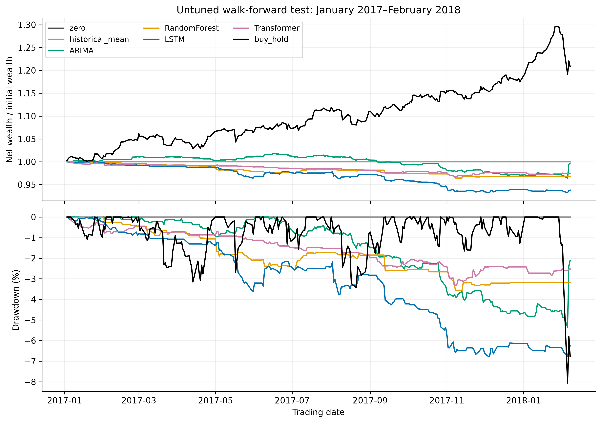
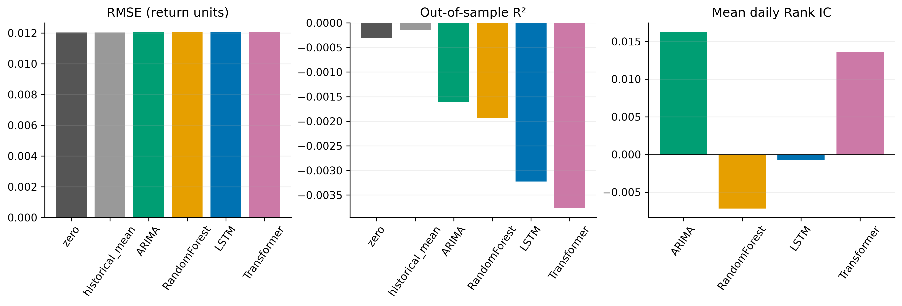
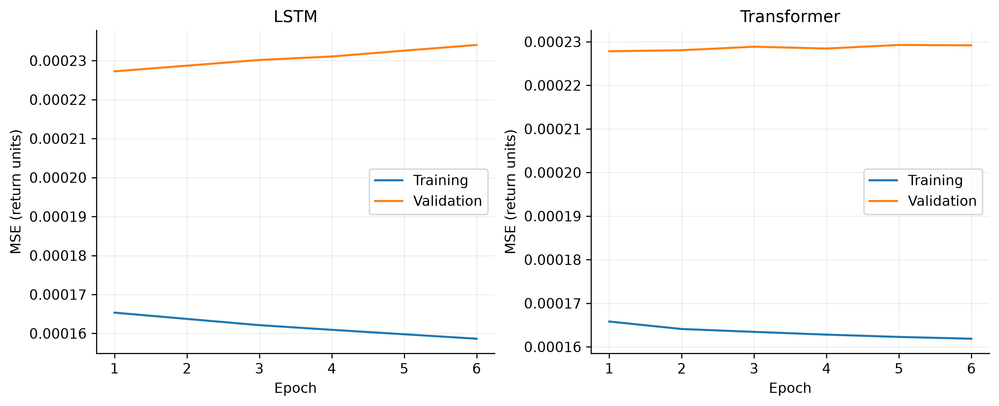
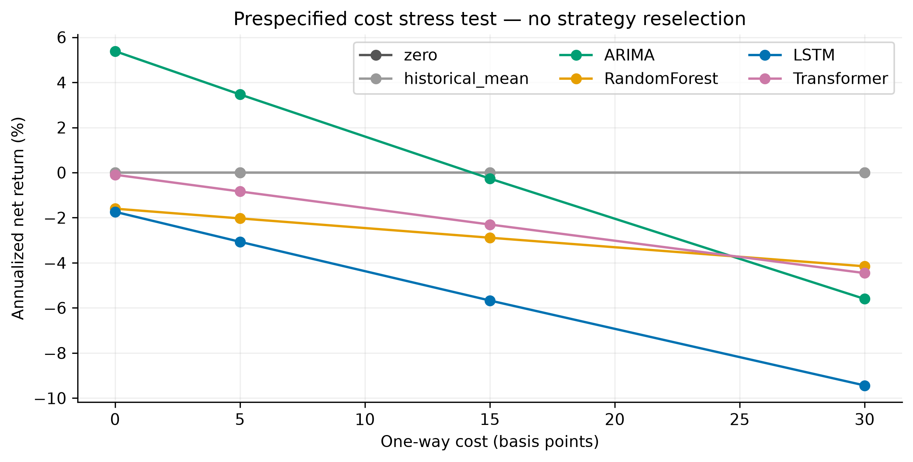

# Reproduction, audit and real-data experiment

## Scope and provenance

Upstream commit: `9b143e407ed878e0694564f953149d0456177433`. Original Kaggle `camnugent/sandp500`, member `all_stocks_5yr.csv`, downloaded 2026-11-24. SHA-256: `6aea253cd19de60b568143991aaf1fa482456565c389205658d236e595e716cf`. 619,040 rows, 505 names, 2013-02-08 through 2018-02-07. Hardware backend: **mps**, PyTorch 2.15.0, Python 3.12.14. Full experiment wall time: 5.31 minutes. No synthetic financial observations or results are used. Tests use clearly isolated toy fixtures.

Historical checkpoints are literal placeholder text; original trades/curve occur in 2022–2023 and cannot derive from the stated dataset. See `audit/AUDIT.md` and its immutable archive for the file-level findings. Original claims are withdrawn. The new target, architectures and protocol differ, so before/after is not a controlled performance comparison.

## Frozen design and information clock

Features are available after close on day t. The model predicts `close[t+1]/open[t+1]-1`; orders are selected after close t, bought at open t+1 and sold at that day's close. Closing exits are scheduled in advance. No current-session feature, overnight return before entry, stop-loss hindsight or same-close signal fill is used.

All 505 source names are allowed, subject to 40 sessions of complete raw history. Eight features (1/5/20-day returns, intraday return, high-low range, overnight gap, 20-day volatility and volume ratio) use only past/current signal-day values. No outcome clipping or return outlier deletion. Missing OHLC rows are not imputed. The source calendar is reindexed for each name so gaps cannot create fictitious adjacent days. Invalid/absent windows: 17,698; initial 40 calendar sessions per name are warmup and counted separately. These exclusions include pre-IPO absence, gaps and rolling warmup after missing data, not just bad original rows. Prediction files contain every eligible evaluation observation.

Each boundary uses a strict purge: the latest training target precedes the earliest raw observation contributing to the evaluation window. Overlap **within** a chronological segment is ordinary causal history reuse; train/evaluation windows have no raw-history overlap. Whole dates remain together. The scaler fits training windows only. Overlapping training windows reweight repeated historical feature rows, an explicit weighting choice. There is no validation/test normalization fit.

| fold | n_train | n_evaluate | max_train_target | min_evaluation_feature_start | evaluation_start | evaluation_end |
|---|---|---|---|---|---|---|
| validation | 314247 | 125052 | 2015-11-03 00:00:00 | 2015-11-04 00:00:00 | 2016-01-04 00:00:00 | 2016-12-30 00:00:00 |
| test_1 | 439083 | 62462 | 2016-11-02 00:00:00 | 2016-11-03 00:00:00 | 2017-01-03 00:00:00 | 2017-06-30 00:00:00 |
| test_2 | 501442 | 63324 | 2017-05-04 00:00:00 | 2017-05-05 00:00:00 | 2017-07-03 00:00:00 | 2017-12-29 00:00:00 |
| test_3 | 564629 | 13108 | 2017-11-01 00:00:00 | 2017-11-02 00:00:00 | 2018-01-02 00:00:00 | 2018-02-07 00:00:00 |

Validation is 2016. It chooses only the neural epoch (1–6) and forest depth (6 or 10). All test folds use the frozen choices. Later test refits may consume earlier observed test labels after the same purge; this is prequential walk-forward training, never hyperparameter or strategy selection. Test results are descriptive, never fed back into design. The interrupted pre-test validation setup is preserved in `audit/interrupted_validation`.

Selected configurations: `{"RandomForest": {"max_depth": 10, "min_samples_leaf": 100}, "LSTM": {"epochs": 1}, "Transformer": {"epochs": 1}}`.

LSTM: one 32-unit layer, linear output. Transformer: one 32-dimensional encoder, four heads, feedforward width 64, dropout 0.1, sinusoidal positions. Both use 20 days, batch 1024, Adam 0.001, clipped gradient norm 1, seed 42, targets scaled by 100 for optimization then inverted. Full past-window attention is valid because every token precedes execution. Forest: 80 trees, sqrt feature subsampling, minimum leaf 100; flattened identical input windows. Models are intentionally modest reproducible baselines, not exhaustive architecture searches. No claim of reproducing the obsolete nominal 128/256-wide architectures.

ARIMA(1,0,0) is fitted per stock on percent intraday returns with missing sessions retained. Parameters are frozen within each fold; next-day forecasts update using the latest observed intraday return. Parameter checkpoints include constant, AR coefficient, variance, convergence and warnings. A documented pooled-mean fallback applies below 100 training observations. Historical mean is the pooled training-target mean held fixed within each fold; zero predicts exactly zero. All six models have identical evaluation observations, including fallback cases.

## Predictive results

| model | n | rmse | mae | r2 | directional_accuracy | ic | rank_ic | icir | ic_valid_days |
|---|---|---|---|---|---|---|---|---|---|
| zero | 138894 | 0.0120386 | 0.00837524 | -0.000306692 | 0.00867568 | undefined | undefined | undefined | 0 |
| historical_mean | 138894 | 0.0120377 | 0.00836924 | -0.000150111 | 0.513658 | undefined | undefined | undefined | 0 |
| ARIMA | 138894 | 0.0120464 | 0.00837543 | -0.00160198 | 0.510692 | 0.01757 | 0.0162988 | 0.179975 | 277 |
| RandomForest | 138894 | 0.0120484 | 0.00837839 | -0.001935 | 0.504838 | -0.00562145 | -0.00719994 | -0.0475285 | 277 |
| LSTM | 138894 | 0.0120562 | 0.00838078 | -0.00322428 | 0.508424 | -0.00265547 | -0.000725685 | -0.0216339 | 277 |
| Transformer | 138894 | 0.0120595 | 0.00837861 | -0.00376845 | 0.515983 | 0.0108702 | 0.0135866 | 0.0950721 | 277 |

RMSE/MAE use decimal returns. R² is `1-SSE/SST` on the common pooled target. Directional accuracy compares three-way signs (-,0,+), so zero's score counts only exact zero returns; it is not a random 50% directional classifier. IC is mean **daily cross-sectional** Pearson correlation; Rank IC uses average-rank Spearman correlation. ICIR is daily IC mean/sample standard deviation, unannualized. Constant cross-sectional forecasts have undefined IC/Rank IC/ICIR, represented as null/blank, not zero. Their valid-day count is zero. These quantities differ from a pooled time-series correlation.

| model | mean_daily_mse_improvement_over_zero | ci_2.5 | ci_97.5 |
|---|---|---|---|
| historical_mean | 2.28882e-08 | -2.75445e-07 | 3.18488e-07 |
| ARIMA | -1.86974e-07 | -5.09518e-07 | 1.47752e-07 |
| RandomForest | -2.35847e-07 | -5.35579e-07 | 3.96884e-08 |
| LSTM | -4.22537e-07 | -8.79125e-07 | -3.88788e-08 |
| Transformer | -5.00644e-07 | -1.21381e-06 | 7.22477e-08 |

The uncertainty intervals use a paired circular moving-block bootstrap of daily average squared-error improvement over zero, block length 20, 2,000 draws, seed 42. Positive improvement favors the model. This accounts approximately for temporal dependence and cross-stock dependence by resampling whole dates. Intervals are unadjusted for multiple models and block-length uncertainty; they are not proof of tradable alpha. No test-based selection is made from them.

## Execution and portfolio results

Fixed long-only rule: rank predictions descending, ticker as deterministic tie break, buy up to 20 whose predicted return is strictly above 0.003. Each receives at most 1/20 starting NAV including entry costs; unfilled slots remain cash. Fractional shares, no leverage or shorts. Both legs pay 10 bp commission plus 5 bp slippage on reference notional (15 bp one way). Cash earns zero. Starting capital $100,000. Every day ends flat; all trades include both legs and reconcile to NAV. The costs are plausible research assumptions, not measured historical spreads or market impact.

Benchmark: buy and hold the 20 stocks with highest median 2016 dollar volume, equal initial dollars, selected before testing. Buy first test open and sell final test close with the same costs. Fixed shares drift naturally. It is an investable source-data basket under these assumptions, **not** the S&P 500 total-return index; it has overnight exposure and concentration differences from the intraday strategy. Missing intermediate marks are forward-valued, but missing boundary execution quotes fail explicitly. Basket is saved in `benchmark_basket.json`.

| model | annualized_return | sharpe | max_drawdown | mean_daily_turnover | annualized_turnover | transaction_costs | final_equity | days |
|---|---|---|---|---|---|---|---|---|
| zero | 0 | undefined | -0 | 0 | 0 | 0 | 100000 | 277 |
| historical_mean | 0 | undefined | -0 | 0 | 0 | 0 | 100000 | 277 |
| ARIMA | -0.00266106 | -0.0559701 | 0.0534298 | 0.145841 | 36.7518 | 6034.66 | 99707.5 | 277 |
| RandomForest | -0.0288734 | -1.92289 | 0.0357106 | 0.0349022 | 8.79534 | 1422.59 | 96830.8 | 277 |
| LSTM | -0.0567182 | -2.19925 | 0.0678384 | 0.108073 | 27.2344 | 4339.27 | 93783.3 | 277 |
| Transformer | -0.023025 | -1.8421 | 0.0333127 | 0.0591137 | 14.8966 | 2414.77 | 97472 | 277 |
| buy_hold | 0.187904 | 1.74872 | 0.0806044 | 0.00718369 | 1.81029 | 331.303 | 120837 | 277 |

Annualized return is terminal wealth CAGR using 252/N sessions; Sharpe is mean daily net return/sample standard deviation times sqrt(252), risk-free rate zero. Maximum drawdown includes initial NAV. Turnover is **two-sided** traded reference notional/starting daily NAV (a full round trip is approximately 2); annualized turnover is daily mean times 252. Transaction costs are cumulative dollars on the compounding equity path. Cash strategy Sharpe is undefined. The final 2018 fold has only a few weeks: its annualized statistics are unstable. All per-fold results are retained, as are zero-, 5-, 15- and 30-bp cost scenarios; none was selected for favorable test performance.

## Before versus after

| model | old_rmse_unverified | new_rmse | old_r2_unverified | new_r2 | old_annual_return_unverified | new_annual_return | old_sharpe_unverified | new_sharpe |
|---|---|---|---|---|---|---|---|---|
| zero | undefined | 0.0120386 | undefined | -0.000306692 | undefined | 0 | undefined | undefined |
| historical_mean | undefined | 0.0120377 | undefined | -0.000150111 | undefined | 0 | undefined | undefined |
| ARIMA | 0.0152 | 0.0120464 | 0.152 | -0.00160198 | undefined | -0.00266106 | undefined | -0.0559701 |
| RandomForest | 0.0143 | 0.0120484 | 0.185 | -0.001935 | undefined | -0.0288734 | undefined | -1.92289 |
| LSTM | 0.0124 | 0.0120562 | 0.248 | -0.00322428 | 0.182 | -0.0567182 | 1.4 | -2.19925 |
| Transformer | 0.0131 | 0.0120595 | 0.221 | -0.00376845 | undefined | -0.023025 | undefined | -1.8421 |

The old RMSE/R² pairs imply incompatible target variances and cannot substantiate a fair comparison. No inference speed or training duration is copied from them. Measured durations for the new fits are in `timings.json`.

## Limitations and scientific interpretation

This is a retrospective survivor-biased universe, not point-in-time S&P membership. Failed/delisted constituents and delisting returns are absent. Selecting from these 505 names already embeds hindsight that chronological ML splits cannot repair. Corporate-action adjustment conventions are not established by this OHLCV file; there is no adjusted-close/dividend series, security identifier history, split event table or ticker-change map. The buy-and-hold calculation is therefore a source-price return, not verified total shareholder return. Intraday labels reduce overnight corporate-action discontinuities but do not solve universe bias or all price-history issues.

Missing execution data cannot be imputed into genuine fills. Eligible-sample comparison excludes unavailable targets; the exclusion ledger records these, and missingness may not be random. The dataset has no auction depth, bid/ask, halts, order rejects or realized impact. Fractional shares and exact reference open/close executions with a fixed cost penalty are approximations. No sector constraints, borrow, tax, dividends or capacity claim is made. A 13-month test dominated by 2017 and one seed cannot establish regime robustness. The test is now inspected; further tuning requires a new untouched period/dataset.

Assess genuine value by improvement over zero **and** historical mean on the common observations, uncertainty and net profitability against the basket. Positive isolated IC, raw return or a favorable fold is insufficient. The numerical results above are retained regardless of sign. See the concise assessment at the end for the observed outcome.

## Reproducibility and artifacts

Run commands in the root README. Checkpoints, scalers, fitted ARIMA coefficients and frozen selections reproduce saved forecasts; `scripts/verify_artifacts.py` checks replay samples and full-ledger identities. Seed and exact package lock are recorded; GPU libraries can cause small cross-platform floating-point differences. For deterministic CPU reference reruns, use `CUDA_VISIBLE_DEVICES=''` plus a local CPU backend selection only in a new output experiment and record that change; do not claim bitwise GPU equivalence. The provided run uses the available GPU automatically.

All original files remain solely in the audit archive. Active results are generated by real fits. Model, trade, prediction, per-day IC, per-fold score and cost-stress files are retained; undefined statistics are explicitly null/blank. Do not load arbitrary untrusted joblib/pickle files.

## Verified scientific assessment

No fitted model beats the better simple baseline in RMSE. All four model strategies lose money after the fixed costs. The tabled results provide no basis for claiming robust predictive or trading alpha from these specific model/rule combinations. Small positive cross-sectional ICs alone are insufficient. Negative R², uncertainty, cash-baseline outcomes and net profitability must be considered together. This does not prove every possible architecture or strategy must fail.

At 15 bp per leg, ARIMA: -0.27% annualized, Sharpe -0.06, RandomForest: -2.89% annualized, Sharpe -1.92, LSTM: -5.67% annualized, Sharpe -2.20, Transformer: -2.30% annualized, Sharpe -1.84, buy_hold: 18.79% annualized, Sharpe 1.75. The benchmark remains subject to survivor and source-price limitations.

validation: 9 explicit insufficient-history ARIMA fallbacks, 0 nonconverged fits, 0 warnings. test_1: 4 explicit insufficient-history ARIMA fallbacks, 0 nonconverged fits, 0 warnings. test_2: 6 explicit insufficient-history ARIMA fallbacks, 0 nonconverged fits, 0 warnings. test_3: 4 explicit insufficient-history ARIMA fallbacks, 0 nonconverged fits, 0 warnings. Fallback observations remain in common-sample evaluation. One seed, a short test horizon, universe bias and unverified corporate-action conventions limit inference. A new point-in-time, dividend-aware dataset and untouched test period are needed for further selection or deployment claims.
